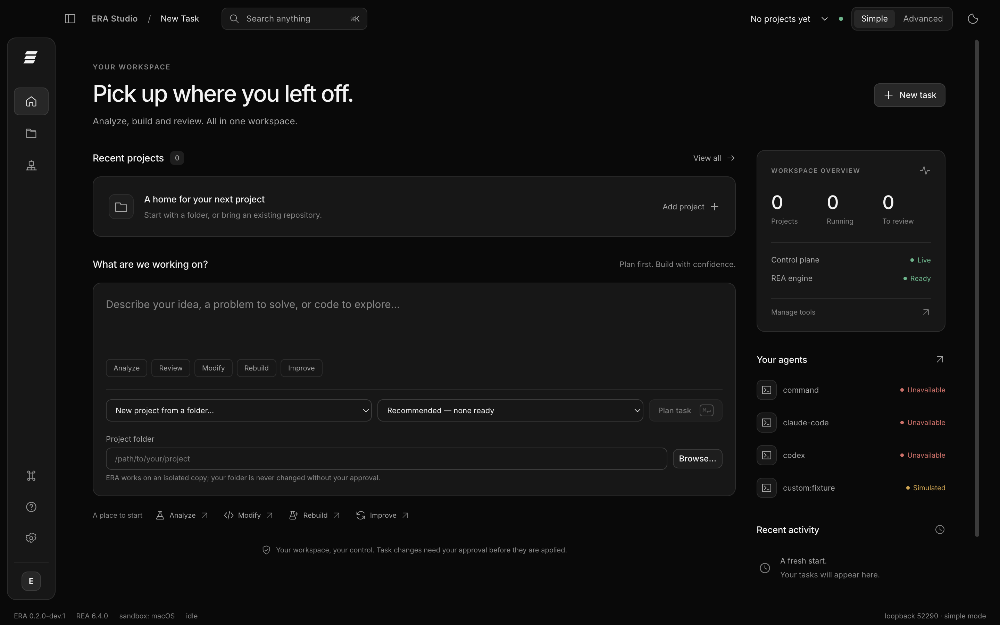

# ERA
## Evolve & Reverse Engineer Anything

**Reverse. Analyze. Evolve. Repeat.**

ERA is an open-source reverse-engineering agent built on the original
**[Reverse Engineer Anything (REA)](https://github.com/morluto/rea)** engine. It
adds three things REA does not provide:

1. **Analysis Mode**: one command (`era analyze`) that routes a target to the
   right REA workflow, records every REA execution, normalizes REA Evidence into
   facts, and writes a report. Untrusted executables run in a sandbox.
2. **ERA Improvement Lab**: a controlled, evidence-driven system in which REA
   reverse engineers ERA itself. Findings become hypotheses, a configurable
   coding agent implements one in an isolated git worktree, and tests,
   ground-truth benchmarks and a second REA self-analysis decide. A maintainer
   approves integration.
3. **Measurement**: hand-written ground-truth benchmarks, version comparison and
   ERA-vs-direct-REA overhead.

Every reverse-engineering fact ERA reports comes from a recorded REA execution.
ERA never re-implements REA, and everything REA offers stays available through
`era rea …`.

> **Status: v0.1.0, experimental.** Verified on macOS 27 (arm64), Node 24 and REA
> 6.4.0. See [what works](#what-works), [limitations](#limitations) and the
> [validation report](docs/validation.md). ERA is not production-ready and has no
> security certification.

---

## What works

Verified on macOS 27 arm64, Node 24.20, REA 6.4.0, Hopper 6.6.0-demo:

| Capability | Command | REA engine call | Verified |
|---|---|---|---|
| JavaScript application analysis (modules, imports, exports, entrypoints, URL literals) | `era analyze <dir>` | `analyze-javascript-application` | ✅ |
| Single JavaScript file | `era analyze <file.js>` | same, on a staged directory | ✅ |
| Mach-O structure | `era analyze <binary>` | `inspect-macho` | ✅ |
| Native decompilation of exported functions | `era analyze <binary>` | `function … --snapshot` | ✅ with Hopper (Ghidra/IDA supported by REA, not tested) |
| Sandboxed runtime capture (no network, writes only to scratch) | `era analyze <binary> --runtime` | `capture-process` under `sandbox-exec` | ✅ macOS |
| Archive inventory (ZIP) | `era analyze <file.zip>` | `inspect-artifact` | ✅ (APK/IPA/DMG routed, not tested) |
| Explanations: local deterministic, or an opt-in model | `era explain <analysis>` | none (reads ERA facts) | ✅ local; remote/command providers tested with fakes |
| Every original REA command, MCP server, agent setup | `era rea …`, `era rea mcp`, `era rea setup` | passthrough | ✅ (real MCP session tested) |
| Improvement Lab: self-analysis, experiments, approval, rebase, rollback, cancel, recover | `era self-analyze`, `era improve …`, `era rollback` | REA self-analysis | ✅ |
| Coding agents | `era improve implement --agent …` | — | `manual` ✅ real; `claude-code`, `codex`, `command` ✅ adapters tested with fake CLIs, not run against real models |
| **Project Lab** (v0.2.0, in development): review, modify or rebuild an authorized *external* project in an isolated copy, with human approval and rollback | `era project …` | REA for JavaScript projects and for Rebuild references | ✅ with scripted *mock* agents + the projects' own tests; **real Codex** validated (small tasks); **Claude Code not validated** (signed out on the dev machine) |
| Benchmarks, version comparison, REA overhead | `era benchmark [--versions …] [--rea-baseline]` | via `era analyze` / direct REA | ✅ |
| Status, history, JSONL logs, static dashboard | `era status`, `era history`, `era dashboard` | `providers` | ✅ |

**Not supported through `era analyze`** (available in REA via `era rea …`):
ELF/PE analysis, Android, firmware, browser and Electron runtime, .NET. On
Linux, Mach-O inspection, Hopper and the runtime sandbox are unavailable.

## ERA and REA

| | REA (upstream, unmodified) | ERA (this repository) |
|---|---|---|
| Reverse-engineering operations (127 CLI commands, 170 MCP tools) | ✅ provides | uses; never re-implements |
| MCP server and agent registration (Claude Code, Codex, Cursor, Gemini CLI, Copilot CLI, VS Code, …) | ✅ `rea mcp`, `rea setup` | reuses through `era rea …` |
| Evidence, unknowns, evidence bundles | ✅ | stores REA Evidence unmodified next to run records |
| Target routing, normalized facts, reports | — | ✅ |
| Sandboxed runtime capture | REA's capture is explicitly not a sandbox | ✅ macOS `sandbox-exec` wrapper |
| Ground-truth benchmarks and version comparison | — | ✅ |
| Self-analysis and the Improvement Lab | — | ✅ |
| Coding-agent and reasoning-provider adapters | — | ✅ |

All of `src/` is ERA-specific. REA is the `rea-agents@6.4.0` dependency (MIT,
© morluto). See [THIRD_PARTY_NOTICES.md](THIRD_PARTY_NOTICES.md),
[docs/original-rea-analysis.md](docs/original-rea-analysis.md) and
[docs/feature-gap-analysis.md](docs/feature-gap-analysis.md).

## Install

There are three different things you can install; pick the one you need.

| You want | Source | Includes ERA Studio |
|---|---|---|
| The stable **CLI** (v0.1.0) | the default branch `main`, or the npm tarball built from it | no |
| The **v0.2.0 development line**: CLI plus ERA Studio (desktop shell or browser) | branch `feature/era-v0.2.0` | yes |
| A **desktop application** | built locally with `npm run package --prefix apps/studio` (unsigned, macOS arm64). No signed or notarized download is published | yes |

The CLI tarball and the default branch do **not** contain `apps/studio`; following the CLI steps and then running a Studio command fails.

```bash
# CLI only (stable)
git clone https://github.com/dav1dngy/era-agent.git && cd era-agent
npm install && npm test && node bin/era.mjs status

# v0.2.0 development line with ERA Studio
git clone --branch feature/era-v0.2.0 https://github.com/dav1dngy/era-agent.git && cd era-agent
npm ci && npm ci --prefix apps/studio
node bin/era.mjs studio doctor        # checks what Studio needs on this machine
node bin/era.mjs studio app           # desktop shell; or: node bin/era.mjs studio serve --open (browser)
```

The remote `feature/era-v0.2.0` branch may be behind the latest local work: fixes described in
[docs/ERA_V020_REMEDIATION.md](docs/ERA_V020_REMEDIATION.md) are in a clone only once they are published. Put `era` on your PATH
with `npm link` (optional). Studio has an in-app **Help** page (sidebar, ⌘K, and F1 in the desktop app) that works offline.

Requirements: Node.js `^22.19 || ^24.11 || >=26` (REA's supported range; verified on 24.20 only), git; Python 3 for the Studio terminal.
Native decompilation needs Hopper, Ghidra 12.1.x (a JDK 21 on `PATH` and `GHIDRA_INSTALL_DIR`; the desktop app imports only your shell's
`PATH`, so start it from that shell) or IDA Pro MCP. ERA needs no API keys. Details, state locations and
troubleshooting: [docs/installation.md](docs/installation.md). What has been verified, on which platform and revision:
[docs/SUPPORT_AND_VALIDATION.md](docs/SUPPORT_AND_VALIDATION.md).

## Analyze software

```bash
era analyze benchmarks/datasets/js-app
era analyze benchmarks/datasets/native-hello/hello
era analyze benchmarks/datasets/native-hello/hello --runtime --arg demo   # sandboxed execution
era analyze benchmarks/datasets/archive/js-app.zip --json
era explain <analysis-id>                 # local explanation; no data leaves the machine
era inspect path/to/target                # classification + engine status
era rea doctor                            # any original REA command
```

Excerpt of a real report ([full report](examples/sample-analysis-report.md)),
decompiled by Hopper through REA from `clang -O1` output:

```c
### _greet @ 0x100000460
    r8 = 0x1505;                       // 5381: djb2 hash seed
    do {
            r8 = r8 + r8 * 0x20 + r9;  // h = h * 33 + c
            ...
    printf("Hello, %s! checksum=%u\n", r19, r8);
```

Static analysis only reads files. `--runtime` executes the target inside a
macOS sandbox (no network, writes only to the analysis scratch directory). Without
a sandbox ERA refuses unless you pass `--unsandboxed`.

## ERA Improvement Lab

```bash
era self-analyze                          # REA analysis of ERA's packed artifact + CLI runtime
era improve propose [--finding ID]        # REA self-analysis → one hypothesis + isolated worktree
era improve implement <cycle> --agent claude-code|codex|command   # or edit the worktree yourself
era improve evaluate <cycle>              # tests + benchmarks + REA self-analysis → rejected | awaiting-approval
era improve show <cycle>                  # reviewable change proposal (report + patch)
era improve approve <cycle>               # maintainer: merge into main and tag era-vN
era improve decline <cycle> | rebase <cycle> | cancel <cycle> | recover
era rollback era-v2                       # restore any version as a new commit
era agents                                # coding agents, reasoning providers, REA
```

**Trust model (since the independent audit).** The stable supervisor runs every
REA execution used to judge a candidate. Candidate code (its tests, its fact
extraction, its self-analysis plan, its CLI) runs only inside a macOS sandbox:
no network, writes only to its own checkout and private temp, no reads of
ground truth, ERA's state or credential stores, and no secret environment
variables. Approval merges exactly the evaluated commit. Without a sandbox,
evaluation refuses unless `--trust-candidate`. See
[docs/audit-remediation.md](docs/audit-remediation.md).

Controls: iteration, time, REA-run and API-cost limits with hard caps. One
experiment at a time. Cancellation kills the whole process tree. A watchdog
ensures no subprocess outlives its deadline or its parent. A protected
evaluator (experiments cannot edit the tests, rules, datasets or acceptance
criteria that judge them). No merge without maintainer approval. Refused in CI. Full
description: [docs/improvement-lab.md](docs/improvement-lab.md).

### Experiments so far

| # | Experiment | Evidence | Decision |
|---|---|---|---|
| 1 | Infer CommonJS export names from REA's semantic graph | F1 0.956 → 0.987, but REA self-analysis findings 7 → 9 | **rejected** (main untouched) |
| 2 | Split REA self-analysis into size-balanced passes | coverage finding resolved, findings 7 → 6 | accepted → era-v2 |
| 3 | Retry #1 on era-v2 | F1 0.956 → 0.987, findings 6 → 5 | accepted → era-v3 |
| 4 | Byte-bounded REA passes with import placeholders (campaign 2) | findings 26 → 7, complete REA coverage | first evaluation passed; **rejected** on re-evaluation (a Hopper-flaky test); retried as #5 |

Cycles 2 and 3 ran before the approval gate existed and were merged automatically; cycle 1 was rejected. Cycles 1–5 were evaluated by the pre-audit evaluator: candidate code ran unsandboxed and self-analysis evidence came from the candidate's own pipeline. The independent audit re-checked the recorded raw outputs (49/49 digests match; cycle 5's findings reproduce), but those evaluations predate the supervisor/sandbox model below. Cycle 5's "104 → 107 tests" means the baseline had 1 failing test (REA coverage) that the candidate fixed.
| 5 | Retry of #4 after the flaky test fix | findings 27 → 9, tests 104 → 107 (0 failed), accuracy unchanged | accepted, **approved by the maintainer → era-v4** |

Every record (cycle JSON, REA run records with output digests, self-analysis
reports, ledger) is in [`experiments/`](experiments/). The narrative is in
[docs/self-improvement.md](docs/self-improvement.md).

## Benchmarks

Measured on macOS 27 arm64, REA 6.4.0, Hopper 6.6.0-demo, 3 repetitions per case,
quiet host (`benchmarks/results/versions-v1-v2-v3.json`,
`benchmarks/results/main-with-rea-baseline.json`):

| Metric | era-v1 | era-v2 | era-v3 | main (RC) |
|---|---|---|---|---|
| Accuracy (F1) | 0.956 | 0.956 | 0.987 | 0.987 |
| Precision | 0.988 | 0.988 | 0.988 | 0.988 |
| Completeness (recall) | 0.933 | 0.933 | 0.987 | 0.987 |
| Execution time (ms, Σ medians) | 37,351 | 44,534 | 47,968 | 51,458 |
| CPU time (s, Σ medians) | 33.18 | 35.26 | 34.19 | 34.06 |
| Peak memory (MB RSS) | 389.6 | 389.6 | 389.8 | 389.5 |
| Error rate | 0.000 | 0.000 | 0.000 | 0.000 |
| Reliability | 1.000 | 1.000 | 1.000 | 1.000 |
| REA executions per pass | 10 | 10 | 10 | 10 |

Wall time is dominated by Hopper start-up and varies by up to ~25% between
identical runs. The rise from era-v1 to main is within that noise for the
native cases, but CPU time is flat. Accuracy is deterministic.

**ERA vs direct REA** (same REA commands, median wall ms; `--rea-baseline`):

| Case | REA direct | ERA analyze | Overhead |
|---|---|---|---|
| js-commonjs-app | 1,786 | 3,555 | +1,769 ms |
| js-esm-app | 1,757 | 3,466 | +1,709 ms |
| native-macho | 20,928 | 19,727 | −1,201 ms (Hopper noise) |
| native-macho-runtime | 25,014 | 22,339 | −2,675 ms (Hopper noise) |
| zip-archive | 713 | 2,371 | +1,658 ms |

ERA added a fixed ~1.7 s per analysis in this run, mostly the `rea providers`
probe. Since the audit remediation the probe runs only for Mach-O targets
(a quick, informal measurement on the ZIP fixture: ~2.37 s → ~1.45 s; the table has not
been re-measured). ERA is **not** faster than REA;
the negative native figures are run-to-run Hopper variance.

Methodology: [docs/benchmark-methodology.md](docs/benchmark-methodology.md).

## ERA Studio (v0.2.0 development)

ERA Studio is the local Electron desktop / browser interface for the existing ERA
backend: natural-language task planning, Simple/Advanced modes, Monaco workbench and
diffs, sandboxed terminal, Project Lab, analysis evidence, Agent Command Center,
Improvement Lab and explicit approval/rollback.

```bash
npm ci --prefix apps/studio
node bin/era.mjs studio doctor
node bin/era.mjs studio app
# Browser alternative: node bin/era.mjs studio serve --open
# Unsigned macOS application: npm run package --prefix apps/studio
```



More captures and what is real or simulated: [docs/ERA_STUDIO.md](docs/ERA_STUDIO.md#visual-tour).

CLI users do not need Studio's optional dependencies. macOS arm64 is validated;
no signed/notarized release is published. Read the [Studio guide](docs/ERA_STUDIO.md),
[architecture](docs/ERA_STUDIO_ARCHITECTURE.md), [security limits](docs/ERA_STUDIO_SECURITY.md)
and [actual validation results](docs/ERA_STUDIO_TESTING.md). No debugger, extension
marketplace, SSO/RBAC or Windows/Linux support is claimed for this development build.

## ERA Project Lab (v0.2.0, in development)

Project Lab applies ERA to **external projects you are authorized to work on**. Three modes:

* **Review**: read-only architecture, security and maintainability review with evidence, severity and file:line locations (REA for JavaScript projects, static checks, an optional read-only coding-agent review whose findings are accepted only if they point at real files, lines and quoted code).
* **Modify**: "fix this bug", "add search", "refactor": ERA establishes a baseline with the project's own tests, plans, lets a configured coding agent change an **isolated copy**, re-runs the tests, detects regressions (including deleted tests), and produces a reviewable diff. You approve before anything touches the original; `rollback` undoes it.
* **Rebuild**: from an authorized reference (for example a program you wrote or may analyze), ERA gathers REA evidence and observed behavior, writes a specification (no decompiled code is handed to the implementer), has an agent build an independent project, and compares it with the reference behavior.

```bash
era project create demo --source ~/code/shop --mode modify --task "Fix the cart total" \
    --test "npm test --silent" --accept-fail "node --test acceptance/cart.test.js" --agent claude-code
era project modify demo && era project show demo
era project approve demo        # confirmation, then the verified diff is applied
era project rollback demo
```

### Multi-agent engineering (v0.2.0, in development)

Modify can coordinate **several coding agents by role**: an architecture agent designs (read-only),
an implementation agent changes the isolated copy, an independent review agent inspects the
verified diff (read-only), and the implementer makes bounded corrections that ERA re-tests.
ERA itself runs the tests, validates the review findings against the real code and decides; you
approve. Roles are configuration (`claude-only`, `codex-only`, `claude+codex`, or any agent per role),
and remote providers need your explicit, recorded consent before any source code is sent.

```bash
era agents                                   # providers, capabilities, availability, sign-in
era project create demo --source ~/code/shop --task "Fix the cart total" --team codex-only \
    --allow-remote codex --accept-fail "node --test acceptance/cart.test.js"
era project team demo && era project modify demo
```

**Validated for real:** OpenAI Codex (all roles, including a real end-to-end run and a real review
that caught a planted flaw). **Not validated:** Claude Code. The CLI on the development machine was
not signed in, so every Claude-specific path was tested only against scripted agents. Evidence and
gaps: [provider-validation.md](docs/provider-validation.md); design and security:
[multi-agent.md](docs/multi-agent.md); setup: [provider-configuration.md](docs/provider-configuration.md);
tests: [multi-agent-testing.md](docs/multi-agent-testing.md).

Per-project state, locks, limits and cost caps; cancellation, interruption and resume;
a sandbox for the project's own code. Docs: [project-lab.md](docs/project-lab.md),
[project-configuration.md](docs/project-configuration.md),
[project-lab-testing.md](docs/project-lab-testing.md). **Limits:** macOS-focused sandbox;
Project Lab has run with scripted mock agents and, for Codex only, real multi-agent runs on small
projects (Claude Code is not validated); it does not recover source code and does not support
arbitrary formats.

## Connect AI agents

ERA keeps three roles separate: REA does the reverse engineering, a **coding
agent** edits ERA in Improvement Lab experiments, and an optional **reasoning
provider** explains analyses.

**Use REA's tools from Claude Code, Codex, Cursor, Gemini CLI, Copilot CLI or VS Code (MCP).**
REA ships the MCP server and the client registration; ERA forwards to them:

```bash
era rea setup --dry-run        # show which installed clients REA would configure
era rea setup                  # register REA's MCP server (REA asks before changing configs)
era rea mcp doctor             # validate MCP startup and tool listing
```

Clients then see REA's tools (for example `analyze_javascript_application`,
`inspect_macho`). ERA's own commands are CLI-only in v0.1.0; there is no
separate ERA MCP server.

**Use Claude Code or Codex as the Improvement Lab coding agent.**

```bash
era agents                                          # what is installed
era improve implement <cycle> --agent claude-code   # claude -p, acceptEdits, --max-budget-usd
era improve implement <cycle> --agent codex         # codex exec -s workspace-write
```

Budgets are configured in `era.config.json` (`improvement.budget`). Both
adapters are tested only against fake CLIs in this release.

## Providers

| Role | Default | Options |
|---|---|---|
| Reverse-engineering engine | REA | — |
| Coding agent | `manual` | `command`, `claude-code` (`claude -p`, `--max-budget-usd`), `codex` (`codex exec -s workspace-write`) |
| Reasoning provider | `none` (local, deterministic) | `command` (for example a local model), `claude-code`; remote providers need `reasoning.allowRemote` **and** `--allow-remote` |

## Security

Authorized targets only. Analyzed artifacts and REA output are untrusted data,
fenced in prompts and never followed as instructions. Runtime capture is
sandboxed. Secrets are redacted from logs and prompts. Least-privilege CI with
SHA-pinned actions, CodeQL, dependency audit, SBOM and provenance attestation.
See [SECURITY.md](SECURITY.md).

## Limitations

* **Experimental.** Improvement-Lab cycles so far were implemented by a coding agent working interactively (`manual` mode), not by
  the `claude-code` or `codex` adapters. The adapters are tested against scripted CLIs; Codex was additionally validated in real runs
  (see [docs/provider-validation.md](docs/provider-validation.md)); Claude Code was never validated against the real CLI.
* Native analysis covers Mach-O only. Hopper's public API exposes no complete
  function bodies, and Hopper occasionally hangs (ERA's watchdog contains it).
* **REA limits observed:** a fixed JavaScript result budget (ERA splits its
  self-analysis around it); no retained call-argument string literals; CommonJS
  member exports are reported as `default` (ERA infers member names and marks
  them as inferred).
* `sandbox-exec` is deprecated by Apple but functional. For project commands, terminals, the Git panel and Lab candidates the profile
  denies network and writes, denies signalling other processes, and closes the home directory and the shared temporary folders for reads
  (toolchains on `PATH`, ERA's own code and the working copy stay readable). Other locations (for example external volumes) remain
  readable, so it is still not a general confidentiality sandbox: analyze hostile binaries on an isolated host. Runtime capture
  of a reference binary uses the same profile; the coding-agent CLIs do not run under it.
  There is no sandbox on Linux, so Lab evaluation fails closed there.
* `era rea …` passthrough runs REA directly: no ERA run records, sandbox,
  watchdog or redaction. Process-group containment does not cover deliberately
  detached descendants or GUI providers such as Hopper.
* Lab benchmarks evaluate ERA's interpretation of supervisor-run REA Evidence.
  The candidate cannot read ground truth, but its extraction code produces the
  facts. Review the patch.
* Raw REA evidence stays private (`.era/runs/`; 198 MB for cycle 5 alone).
  Published exports carry its SHA-256 digests, and anonymized files keep the
  original Evidence IDs.
* Benchmarks use five small authored fixtures; scores are not representative of
  arbitrary software. No type checking (JSDoc/TypeScript) yet.
* ERA does not modify, retrain or fine-tune any foundation model.
  "Self-improvement" means changes to ERA's own source code.

## Roadmap

* **v0.2.0**: Project Lab, configurable multi-agent engineering and ERA Studio are
  implemented in development on `feature/era-v0.2.0`. Next: independent engineering
  and security review, signed distribution and broader platform validation.
* **v0.3.0**: multi-agent verification, advanced workflows, team collaboration,
  role-based permissions.

## Acknowledgements

ERA would not exist without **Reverse Engineer Anything (REA)** by
[morluto](https://github.com/morluto) and its contributors
(<https://github.com/morluto/rea>). REA provides every reverse-engineering
capability ERA uses. ERA is an **independent open-source project**. It is not
affiliated with or endorsed by the REA authors, and it does not modify or
redistribute REA's source (REA is installed from npm as a dependency).

## Development

ERA was developed by [dav1dngy](https://github.com/dav1dngy) together with
**Claude** (Anthropic) using [Claude Code](https://claude.com/claude-code), which
wrote and tested most of the implementation and acted as the coding agent in the
Improvement Lab experiments. Claude is credited as a co-author in the commit history.

## Contributing and license

See [CONTRIBUTING.md](CONTRIBUTING.md), [docs/testing.md](docs/testing.md) and
[docs/release-checklist.md](docs/release-checklist.md). ERA is MIT-licensed
([LICENSE](LICENSE)). It integrates **Reverse Engineer Anything** by morluto
(MIT); see [THIRD_PARTY_NOTICES.md](THIRD_PARTY_NOTICES.md).
